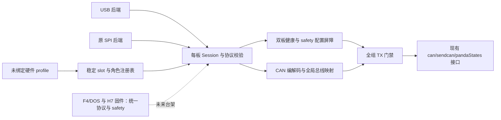

# DOS/F4 与 USB 双 Panda 兼容层设计

2026-10-18。状态：**本地设计完成，兼容层尚未实现，验收用例尚未执行。** 本轮不连接 C3XL、不修改上游源码、不运行硬件入口、不构建或刷写新固件。已锁定的 openpilot `35e78a9d`、panda `a5919516`、opendbc `b3bd79a6` 保持不变。

用户已说明无法提供照片和厂家资料。这不阻止接口设计、纯逻辑测试和候选 F4 工程构建；板型、GPIO、MCU 容量、bootstub 和恢复路径仍作为**实机阶段未通过的条件**，不再作为本地设计的前置材料请求。外观类似官方 C3X 不足以替代这些信息。本机无驾驶员相机、无电话卡功能的配置继续保留。

## 设计选择

1. **主机做 USB/SPI 抽象，Panda 固件以统一的新版协议和当前 opendbc safety 为正式目标。** 旧 SP098 协议仅作为离线解码和差异核对输入，不把旧固件包装成已经满足新版控制要求。暂不刷固件不等于承诺以后只改主机即可部署。
2. **两块板按显式身份绑定到稳定逻辑槽位。** 不依赖 USB 枚举次序，不固定 DOS 为第0块。旧 SP098 把内部板排最后，DP 参考把内部板排最前，两套顺序不能混用。真实绑定缺失时，模板保持未绑定；离线 fixture 同时覆盖两种排列。
3. **第一版保留现有 cereal 消息格式，固定两块 required Panda。** `pandaStates` 长度固定为2；缺板、短读、过期或协议不符使整个 Event 无效并关闭全组 TX。占位条目不是实时健康值，不能压缩列表或由剩余板顶替。每板 age、连接代次和错误保留在会话状态/本地诊断。暂不支持缺一块仍继续控制；若以后需要这种能力，另行设计消息扩展。
4. **发现、传输、协议、控制会话和维护工具分开。** 构造对象不再自动 reset/flash；版本不符返回不可用状态。启动路径不调用恢复、GPIO/USB role 写入或更新器，不以跳过版本校验代替适配。未来真实控制会话仍有心跳、CAN配置和safety设置等写操作，不能称为只读；本轮及离线测试只接 mock。
5. **保留现有 H7/SPI 路径作为回归对象。** F4 分支只恢复芯片/BSP/资源差异，不维护另一份旧车型 safety。车型控制器、宋 PLUS safety 和驾驶员监控硬件属于独立工作线。

## 要修改的模块

下表路径相对官方仓库；具体行号、哈希、旧参考来源见 [主机设计](host-design.md) 与 [固件设计](firmware-design.md)。标为新增的名字是拟议文件，不是已经存在的实现。

| 层 | 修改或新增位置 | 具体改变 |
| --- | --- | --- |
| profile/身份 | 拟新增 `openpilot/selfdrive/pandad/board_profile.*`、`board_registry.*`；`main.cc` | profile记录slot、身份条件、transport、角色、协议、能力和必需板数；显式选择单SPI或双USB；未知/重复身份拒绝绑定。私有序列号以后仅存本地配置。 |
| 传输 | `panda_comms.h`、`spi.cc`；拟新增 `usb.cc`；`SConscript` | 公共handle接口，保留SPI；实现独立libusb handle/锁/错误状态及短包/分片/超时/取消；移除硬件副作用构造；把纯逻辑测试目标从Linux硬件构建中分离。 |
| 协议与能力 | `panda.h/.cc`、`panda/python/__init__.py`、`panda/python/constants.py`、`board/main_comms.h`、`board/health.h`、`opendbc/safety/can.h` | 显式旧/新布局；精确长度和版本hash校验；C++/Python/MCU共享wire契约；F4只允许经典CAN，不能截断FD；firmware hash按板/MCU/profile匹配。 |
| 多板管理与路由 | `pandad.h/.cc`、`panda.h/.cc`；拟新增 `session_registry.*`、`can_router.*` | 每板独立RX残包/代次/队列；固定slot，发送先选板再减offset，接收加offset再组合标志；掉线清旧包，重连重新验证，绝不自动迁移总线。 |
| safety与外围 | `panda_safety.cc`、`pandad.cc`、硬件角色接口 | `safetyConfigs[slot]`逐板设置和读回；身份/协议/配置全部成功才解除模拟门禁。风扇、电流、IR、点火、线束、供电按角色与能力选择；不复制DOS假点火或未知GPIO配置。 |
| 消费者 | `openpilot/selfdrive/selfdrived/selfdrived.py`、`openpilot/system/hardware/hardwared.py`、`openpilot/selfdrive/car/card.py`、`opendbc/car/__init__.py`、相关UI/测试 | 检查完整固定板数、消息有效/新鲜和角色一致；在本适配profile中消除`[0]`代表线束板、列表长度代表车辆板offset的隐含假设，并保持其他官方车型默认行为；显示缺板不能伪装正常。v1不修改cereal schema。 |
| F4/BSP/构建 | `panda/SConscript`、`board/boards`、拟恢复`board/stm32f4`、驱动、启动文件/链接脚本、`tests/libpanda` | 选择有出处的完整F4基础，再移植DOS板支持；按F4重设资源预算，统一新版接口和safety。不会把旧板头文件当作完整可构建BSP。 |
| 维护与验证 | `pandad.py`、版本/产物清单；host测试、Panda单测与CI | 将自动刷写/恢复从运行入口移出；产物记录精确源码、工具链、MCU/ABI/应用入口和签名类型；本地build与设备install分开。旧bootstub不因移植自动替换。 |

## 总线与故障契约

`host_bus = 4 × logical_slot + local_bus`。步长4是编号空间，不是每块板有4个物理CAN口；当前普通CAN仅允许local 0/1/2，slot0是0/1/2，slot1是4/5/6，3/7保留并拒绝普通TX。**板上 safety 始终看到 local bus**，不会把4/5/6写进MCU白名单。

RX returned使用0x80、rejected使用0xC0编码；先分别解析标志和基础总线，再加slot offset。异常双标志、非法总线、坏校验和截断帧明确报错。TX只接受未带这些标志的普通总线；不能用`%4`或无条件掩码把回执变成新发送。

两板数据没有硬件同步时间戳保证：保持每板顺序和主机单调接收时间，不声称跨板精确先后。代次变化时丢弃半帧、待发队列及旧配置；旧的sendcan、未来时间戳或旧代次请求都不能重发。任何必需板失效使全组不可用；健康板上的退出/心跳行为在未来控制会话明确处理，MCU自身watchdog仍须独立工作。主机门禁不是MCU safety的替代。MCU拒绝TX、relay故障或FWD阻断后，不能绕另一块板或诊断模式重发。软件watchdog的fault记录与心跳超时进入SILENT是不同路径，必须分别验收。

`sendcan Event.valid=false`一律拒绝；重新聚合RX不能刷新旧帧的接收年龄。超时、锁等待、队列容量/年龄、健康有效期和退出/取消上限，必须在各实现验收前冻结为带依据的数值，测试阈值前/等于/后的边界；本设计不编造已验证的实时预算。

现有cereal `CanData`没有独立FD字段，≤8字节帧也可能是CAN FD。第一版保留H7现有自动模式和声明的总线能力，不支持额外的逐帧经典/FD选择；不能把FD标志藏进src。F4拒绝FD位，即使数据长度≤8。

## 实现顺序与离线验收

所有下列阶段目前均为 **PLANNED / NOT RUN**。本轮只验证设计包来源、依赖与覆盖关系，不将计划中的测试写成已通过。

| 顺序 | 交付物 | 离线验收条件 |
| --- | --- | --- |
| P0 契约和隔离入口 | 未绑定profile、身份/能力类型、mock transport、拒绝TX的默认状态 | 双板模板无法直接用于设备；未知身份/重复身份/未定义角色拒绝；导入、构造、测试没有设备打开、GPIO、reset或flash调用。 |
| P1 协议纯逻辑 | 新版wire codec和明确隔离的旧版decoder | 新0xdd恰好8字节，旧3字节进入legacy分支；health 48/58字节精确区分；字节向量与独立oracle相符；坏长度/校验/标志失败；F4拒绝FD与DLC>8。 |
| P2 USB后端与SPI回归 | libusb适配、每板handle、错误/超时契约 | mock覆盖短读、分片、超时、断开、取消及两handle并发；读写有界；一板阻塞不饿死另一板；原H7/SPI黄金用例保持一致。真实USB时序尚未验收。 |
| P3 双板会话和路由 | 固定slot、角色、epoch与CAN路由器 | 正反枚举序列结果一致；两种角色排列均通过；0/1/2与4/5/6不串板；重连/替板/缺板不重编号、不重发旧帧；溢出可见，不静默丢包。 |
| P4 消息/safety/外围整合 | 双pandaStates、配置屏障及消费者修改 | safetyConfigs与slot一一对应；短读/缺板/配置失配导致全组无效和零模拟TX；无隐式ELM327发送；线束/点火/风扇/IR按角色；schema保持兼容。 |
| P5 F4工程与资源 | 完整有出处BSP、DOS候选app、独立H7 app、资源报告 | 两目标分别编译链接；ABI尺寸/offset/hash一致；Flash/RAM/栈/中断资源符合明确芯片预算；不越bootstub/provisioning区域。预算或芯片未明时只得候选构建，不得称实物兼容。P5可在P1后与P2–P4并行。 |
| P6 故障注入与安全回归 | host mock集成、共同safety/MCU抽象测试 | 冻结健康、USB消失、重连、乱序、坏帧、overflow、safety未读回均能验证拒绝路径；F4/H7同一safety语义；不得通过allOutput或跳过校验使测试通过。 |
| P7 独立维护封装 | 分仓补丁序列、lock/产物清单、离线CI和验收报告 | 从固定源码/缓存工具链重建，记录差异与产物hash；单H7/SPI回归不退化；没有自动下载/安装/刷写；所有must用例实际通过才标离线兼容层完成。实机门槛仍单独保留。 |

共41项主验收标准，全部未执行；host/firmware子清单用于细化，不累加为通过项数。逐项输入、预期行为和验收证据见 [offline-acceptance.json](offline-acceptance.json)；阶段依赖和模块归属见 [implementation-plan.json](implementation-plan.json)。目前macOS完整minimal结果没有编译Linux的真实pandad；未来纯逻辑测试与Linux主机链接、F4/H7交叉编译需要分别报告，不可互相代替。

## 已有基础、仍缺的实现和实机条件

已有：固定完整官方源码/依赖；历史macOS构建与H7开发固件编译；DOS软件身份和USB拓扑证据；两代Panda协议定义；现有参考实现与本轮修改清单。**这些基础没有实现双USB runtime，也没有证明当前F4固件可以配新版主机。**

缺的实现就是P0–P7。缺少照片/厂家资料已在 [hardware-assumptions.json](hardware-assumptions.json) 记录为不可获得输入；设计使用未知值与模拟板型，不将“外观相似”升级为已确认。以后实机仍需精确身份/布局、外置板连接和协议、恢复路径等证据；现阶段不再等待用户补照片。

无驾驶员相机、目标AGNOS/QCOM运行、车辆接线、宋PLUS控制协议及专用safety均不由本兼容层自动解决。只允许离线结论；本设计没有生成部署包、安装命令或实车控制实现。

本轮复核入口：`python3 hardware/design/dos-usb-dual-panda/verify.py`。它只验证文档、固定源码锚点和计划覆盖，不执行Panda代码或计划中的实现测试。

默认检查可在不带私有归档的克隆中运行；它明确跳过4份工程外的旧SP098明文参考。本机可追加`--check-local-archives`验证这4份文件的哈希，不复制归档内容。本轮结果见 [VALIDATION.md](VALIDATION.md)。
